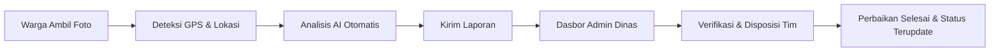

<div align="center">

  

# 🛣️ Rata.in

**Platform Cerdas Pelaporan & Pemantauan Kerusakan Jalan Berbasis AI Computer Vision**

_Mewujudkan infrastruktur jalan yang lebih aman, nyaman, dan terawat bersama partisipasi aktif warga._

[](https://react.dev/)
[](https://vitejs.dev/)
[](https://tailwindcss.com/)
[](https://reactrouter.com/)
[](https://sdgs.un.org/goals/goal11)

</div>

---

## 📌 Daftar Isi

- [Tentang Rata.in](#-tentang-ratain)
- [Fitur Utama](#-fitur-utama)
- [Alur Kerja Sistem](#-alur-kerja-sistem)
- [Daftar Halaman & Rute](#-daftar-halaman--rute)
- [Teknologi yang Digunakan](#-teknologi-yang-digunakan)
- [Struktur Folder](#-struktur-folder)
- [Panduan Instalasi & Penggunaan](#-panduan-instalasi--penggunaan)
- [Skrip yang Tersedia](#-skrip-yang-tersedia)
- [Kontribusi & Lisensi](#-kontribusi--lisensi)

---

## 📖 Tentang Rata.in

**Rata.in** adalah aplikasi web inovatif yang dirancang untuk mempercepat pelaporan dan penanganan kerusakan jalan di area perkotaan. Dengan memanfaatkan integrasi **AI Computer Vision**, sistem dapat mengklasifikasikan jenis dan tingkat keparahan kerusakan secara otomatis dari foto yang diunggah warga.

Proyek ini selaras dengan agenda **SDG 11 (Sustainable Cities and Communities)**, mendorong terciptanya mobilitas warga yang lebih aman dan respons perbaikan fasilitas umum yang lebih transparan dan terukur bagi dinas terkait.

---

## ✨ Fitur Utama

### 1. 📷 Alur Pelaporan Cerdas (4-Step Report Flow)

- **Unggah & Ambil Foto**: Fleksibilitas memilih foto dari galeri perangkat atau mengambil foto langsung (_live camera / webcam_).
- **Deteksi Lokasi Presisi**: Pengambilan koordinat GPS otomatis (_Geolocation API_) dilengkapi _reverse geocoding_ nama jalan serta opsi penandaan manual pada peta.
- **Analisis AI Computer Vision**: Klasifikasi otomatis jenis kerusakan (retak, lubang) dan tingkat keparahan (_Ringan_, _Sedang_, _Berat_) disertai estimasi rekomendasi penanganan.
- **Konfirmasi Data**: Ringkasan lengkap sebelum pengiriman formulir laporan.

### 2. 🗺️ Peta Interaktif Kerusakan Jalan

- Visualisasi sebaran titik jalan rusak di peta kota.
- Filter tingkat keparahan (_Berat_, _Sedang_, _Ringan_).
- Ringkasan statistik jumlah laporan jalan yang perlu prioritas penanganan.

### 3. 🛡️ Dasbor Manajemen Dinas (Admin Panel)

- Pemantauan metrik laporan harian, mingguan, dan bulanan secara _real-time_.
- Tabel data laporan terpadu dengan penanda status kerusakan.
- Panel verifikasi bukti foto warga, penugasan tim perbaikan (UPT), dan input catatan dinas.

### 4. 🔍 Pelacakan Status Real-Time

- Pemantauan status pengerjaan laporan oleh warga secara transparan:
  `Laporan Dikirim` ➔ `Analisis AI` ➔ `Diverifikasi` ➔ `Proses Perbaikan` ➔ `Selesai`.

### 5. 🔐 Autentikasi Pengguna Modern

- Halaman **Masuk (Login)**, **Pendaftaran (Register)**, dan **Lupa Kata Sandi (Forgot Password)**.
- Desain _split-screen_ modern, ilustrasi visual interaktif, dan tampilan adaptif untuk perangkat seluler maupun desktop.

---

## 🔄 Alur Kerja Sistem



---

## 🧭 Daftar Halaman & Rute

| Rute URL           | Halaman            | Deskripsi                                                            |
| :----------------- | :----------------- | :------------------------------------------------------------------- |
| `/`                | **Beranda**        | Informasi pengenalan Rata.in, statistik ringkas, dan CTA lapor       |
| `/report`          | **Alur Laporan**   | Form 4 langkah (Upload foto, pilih lokasi, analisis AI, konfirmasi)  |
| `/status`          | **Status Laporan** | Riwayat dan pemantauan progres perbaikan jalan warga                 |
| `/peta`            | **Peta Kerusakan** | Peta interaktif persebaran titik jalan rusak dan statistik keparahan |
| `/admin`           | **Dasbor Admin**   | Portal dinas untuk verifikasi laporan dan disposisi tim perbaikan    |
| `/login`           | **Masuk**          | Autentikasi akun pengguna dengan opsi email dan Google Sign-in       |
| `/register`        | **Daftar**         | Pembuatan akun warga baru dengan verifikasi persetujuan              |
| `/forgot-password` | **Lupa Password**  | Pemulihan akses akun melalui verifikasi kode OTP                     |

---

## 🛠️ Teknologi yang Digunakan

- **Frontend Core**: [React 19](https://react.dev/)
- **Build Tool**: [Vite 8](https://vitejs.dev/)
- **Styling**: [Tailwind CSS v4](https://tailwindcss.com/) dengan konfigurasi token tema kustom
- **Routing**: [React Router v7](https://reactrouter.com/)
- **Typography**: Poppins Font Family
- **Linter**: [ESLint](https://eslint.org/)

---

## 📂 Struktur Folder

```text
rata-in-web/
├── public/                     # Aset publik & favicon
├── src/
│   ├── assets/                 # Aset gambar, ilustrasi, dan icon
│   │   └── img/
│   ├── components/             # Komponen UI umum yang reusable
│   │   ├── layout/             # Navbar, Footer
│   │   ├── Badge.jsx           # Komponen indikator status
│   │   └── Stepper.jsx         # Indikator progres langkah form
│   ├── features/               # Modul fitur khusus
│   │   └── report/             # Langkah form pelaporan (Upload, Location, AI, Confirm)
│   ├── pages/                  # Halaman aplikasi web
│   │   ├── AdminDashboard.jsx  # Dasbor pengelola dinas
│   │   ├── ForgotPassword.jsx  # Halaman lupa password
│   │   ├── Home.jsx            # Halaman utama (Landing Page)
│   │   ├── Login.jsx           # Halaman autentikasi login
│   │   ├── Map.jsx             # Peta persebaran jalan rusak
│   │   ├── Register.jsx        # Halaman pendaftaran pengguna
│   │   ├── ReportFlow.jsx      # Halaman utama alur pelaporan
│   │   └── Status.jsx          # Halaman pelacakan status laporan
│   ├── App.jsx                 # Routing utama aplikasi
│   ├── index.css               # Styling global & konfigurasi tema Tailwind CSS
│   └── main.jsx                # Titik masuk utama aplikasi React
├── package.json                # Dependensi dan script proyek
├── vite.config.js              # Konfigurasi Vite
└── README.md                   # Dokumentasi proyek
```

---

## 🚀 Panduan Instalasi & Penggunaan

Ikuti langkah-langkah berikut untuk menjalankan proyek di komputer lokal:

### 1. Prasyarat

Pastikan Anda telah menginstal:

- [Node.js](https://nodejs.org/) (versi 18.x atau lebih baru)
- Paket manajer `npm`, `yarn`, atau `pnpm`

### 2. Kloning Repositori

```bash
git clone https://github.com/NBFiidly/rata-in-web.git
cd rata-in-web
```

### 3. Instal Dependensi

```bash
npm install
```

### 4. Jalankan Server Pengembangan

```bash
npm run dev
```

Buka browser dan akses alamat lokal:

```text
http://localhost:5173
```

---

## ⚙️ Skrip yang Tersedia

Di dalam direktori proyek, Anda dapat menjalankan perintah berikut:

| Perintah          | Deskripsi                                                                    |
| :---------------- | :--------------------------------------------------------------------------- |
| `npm run dev`     | Menjalankan server pengembangan Vite dengan Hot Module Replacement (HMR).    |
| `npm run build`   | Melakukan kompilasi dan optimasi bundle untuk tahap produksi (_production_). |
| `npm run preview` | Menjalankan preview lokal dari hasil build produksi.                         |
| `npm run lint`    | Menjalankan pemeriksaan kode menggunakan ESLint.                             |

---

## 🤝 Kontribusi & Lisensi

Proyek ini dikembangkan sebagai bagian dari **Projek Tugas Akhir** untuk menghadirkan solusi teknologi pelaporan infrastruktur kota yang cerdas dan inklusif.

Masukan, kritik, maupun _pull request_ sangat dipersilakan untuk pengembangan aplikasi ini lebih lanjut!

<div align="center">
  <sub>Dibuat dengan ❤️ untuk jalanan kota yang lebih rata dan aman.</sub>
</div>
